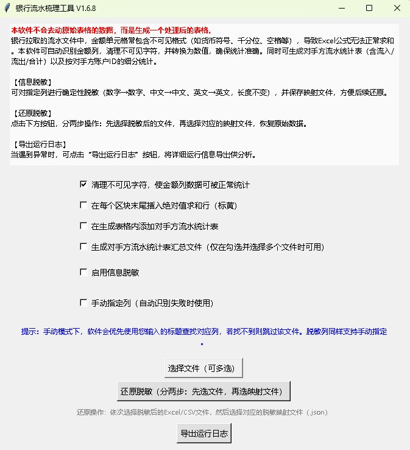
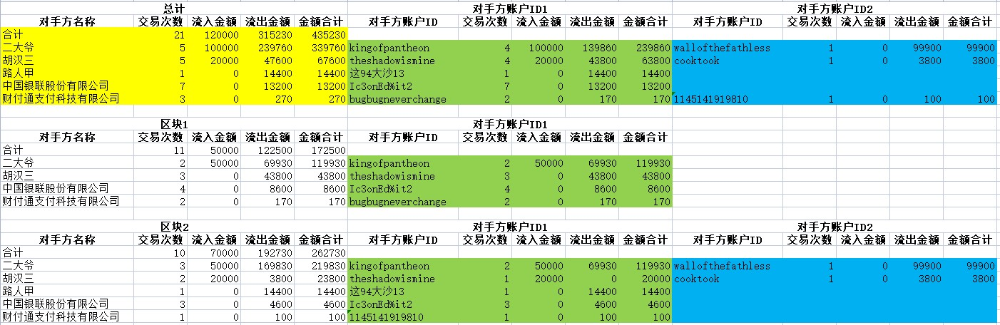

# 银行流水梳理工具 V1.9.9

一款免费、离线的银行流水表格处理工具，可自动识别多区块流水文件，清理金额列不可见字符（货币符号、千分位等），并生成按对手方分类的统计表（含流入/流出/合计及对手方账户ID细分）。

同时提供一套**口令派生的格式保留加密**脱敏：加密后表格照常打开、排序、筛选，只凭「文件 + 口令」即可还原，不需要任何附带文件。

## 🆕 V1.9.9 更新内容

**脱敏彻底重做**，其余功能保持原样。

旧的脱敏是「随机换字 + 附带明文映射表」：没有密钥、可被枚举反推、映射表一丢就永久还原不了，而且同一次处理会对同一个格子脱敏两次（文件里是第 2/3 代密文，映射表只到第 1 代，还原必然失败且不报错）。

现在换成 **口令派生的格式保留加密**：

- 密钥 = `PBKDF2-HMAC-SHA256(口令, 随机盐, 20 万次)` → HKDF 分出加密 / 校验密钥
- 密文仍是「数字→数字、汉字→汉字、长度不变」，表格照常打开、排序、筛选
- 盐写进 xlsx 自定义属性，**只凭 文件 + 口令 就能还原**，不需要金库或映射文件
- 元数据（作者 / 最后修改人 / 时间）全部清空

选列窗口新增：

| 选项 | 作用 |
|---|---|
| 全选 / 全不选 / 反选 | 一次勾完再点掉不要的；同名表头合并成一行，勾一次 = 两列一起加密 |
| 一份文件一把盐 | 勾上则每个文件独立盐，文件之间密文对不上 |
| 随机化加密 | 同一值每次密文都不同（+2 字符 nonce），抗频率分析，代价是失去分组能力 |
| 加密轮数 | 默认 12，可填 1~999，轮数写进文件，还原时自动读取 |
| 表头标题行也加密 | 连列名一起变密文 |

**完整性印记**：加密时对整表算 HMAC 写进文件属性，还原前校验。改一个值 / 加一行 / 删一行会弹窗「这份数据被改过」；排序、筛选、拖行不误报。

**金额梳理与脱敏互斥**：勾了脱敏，求和 / 统计表 / 跨文件汇总 / 金额清理 整组置灰并清零，避免「统计出密文之和」。

完整说明见 [`银行流水梳理工具/V1.9.9 更新说明.txt`](银行流水梳理工具/V1.9.9%20更新说明.txt)。

## ✨ 主要功能

- 支持 Excel（.xlsx / .xls）和 CSV 格式流水文件
- 自动识别表头行、金额列、对手方名称列、对手方ID列、交易方向列
- 智能切分文件中的多个用户/区块（重复表头）
- 可选：清理金额列不可见字符，转为纯数值，确保公式可正常统计
- 可选：在每个区块末尾插入绝对值求和行（黄色高亮）
- 生成内部统计表（对手方统计汇总）：
  - 总计区域 + 各区块独立区域
  - 按对手方汇总流入/流出/合计，并横向列出每个对手方账户ID的细分统计
  - 总计区域A~E列黄色背景，ID块绿蓝交替颜色
- 支持跨文件汇总：处理多个文件时自动生成一份“对手方汇总统计.xlsx”汇总表
- **信息脱敏**：口令派生的格式保留加密，可逆、可凭口令跨机器还原；与金额梳理互斥
- 提供日志导出功能，便于排查异常

## 🔐 脱敏与还原怎么用

**加密**

1. 勾选「启用信息脱敏」（勾上后金额梳理类选项会自动置灰）
2. 选择文件 → 弹出选列窗口，勾要加密的列（可先点全选）
3. 底部按需勾选「一份文件一把盐 / 随机化加密 / 表头也加密」，可填加密轮数
4. 输入口令（至少 6 位，建议 8 位以上、数字+大小写字母），可填密码提示
5. 完成后生成 `xxx_已处理.xlsx`，**不产生任何附带文件**

**还原**

1. 点「还原脱敏（选文件 → 输口令）」
2. 选文件 → 输当时的口令（对话框里会显示文件里记着的密码提示）
3. 口令错会当场被指纹拦下，不会解出一堆乱码

**发给别人**

对方只要拿到 `.xlsx` + 你告诉他口令，装同款软件就能解。不需要金库、不需要提示文件。

## 🖼️ 界面截图





## 📥 下载与使用

### 方式一：直接使用打包好的 exe（无需 Python 环境）

1. 进入 [Releases](../../releases) 页面，下载最新版 **`BankFlowTool_V1.9.9.exe`**
   - 直链：`https://github.com/kingofpantheon/BankFlowTool/releases/download/v1.9.9/BankFlowTool_V1.9.9.exe`
   - 说明：GitHub 会把发布资产名里的中文替换成下划线，所以资产用英文名；程序标题、界面与日志文件名仍是中文的「银行流水梳理工具」
   - SHA256：`E109C610AB6E0F82B3A551D3CDC9E294A5F1F96C9C33D730F00F00B9A6B0850B`
2. 双击运行，GUI 界面操作，按提示选择流水文件即可

### 方式二：修改源代码（需 Python 3.8+）

1. 克隆本仓库
2. 以记事本打开修改.py格式的源代码
3. 在根目录放置唯一的.ico格式的你想要的图片
4. 双击 打包成EXE就双击我.bat 自动安装运行环境及依赖库后即可打包
5. 双击运行，GUI 界面操作，按提示选择流水文件即可

## 📖 使用说明

1. 启动软件后，勾选所需功能（「清理不可见字符」默认不勾）
2. 点击“选择文件（可多选）”，选取银行流水文件
3. 等待处理完成，生成的文件将在原始文件同目录下，文件名后缀为 _已处理.xlsx
4. 若勾选“生成对手方流水统计表”，处理后的 Excel 内会新增一个名为“对手方统计汇总”的工作表
5. 若同时处理多个文件并勾选“生成对手方流水统计表汇总文件”，则会在第一个文件目录下生成 对手方汇总统计.xlsx
6. 脱敏不再保存映射文件；还原只需文件 + 口令（见上文「脱敏与还原怎么用」）

## 🔧 兼容性说明

- 可还原 **V1.8.3 及以后**生成的文件（文件里记了盐）
- **V1.8.2 及更早**生成的文件没记盐，只能配合当时的 `脱敏金库_*.vault` 用老版本还原，或拿原始数据重跑
- **V1.7.x** 的历史文件是「多代叠加」产物，需走 `tools/` 里的多代反查脚本

## 🛠 技术要点

- 自动识别表头行基于关键词匹配（支持银行常用列名）
- 金额列识别通过数值占比判断
- 对手方ID列及方向列使用表头关键词匹配
- 区块切分基于重复表头行特征
- 脱敏算法：格式保留加密（FPE，swap-or-not 构造），HMAC-SHA256 作轮函数，
  数字/大小写字母/汉字各自成域，标点原样保留
- 密钥派生：PBKDF2-HMAC-SHA256（20 万次）+ HKDF 域分离
- 完整性：整表内容多重集的 HMAC-SHA256，写入文件 `description`

## 📦 项目结构

```
银行流水梳理工具/
  ├── 源代码 以记事本打开修改.py      # 主程序（单文件，stdlib + pandas/openpyxl/xlrd）
  ├── 打包成EXE就双击我.bat           # 一键打包（自动装 Python 与依赖）
  ├── 软件图标 请确保根目录只有一个.ico文件.ico
  └── V1.9.9 更新说明.txt
tools/
  └── selfcheck.py                    # 打包前静态自检（漏定义方法 / tkinter 名字裸用）
screenshots/
README.md
RELEASE-v1.9.9.md
```

## 📄 许可证

本项目采用 MIT License（若添加了 LICENSE 文件）。欢迎自由使用、修改和分发。

## 🙏 致谢

如果本工具对你有帮助，欢迎给个 Star ⭐ 或分享给需要的人。
